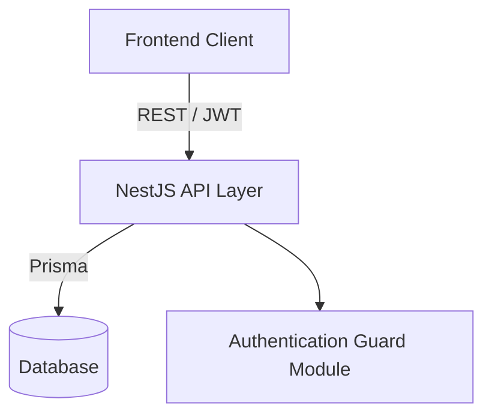

# HealthOps Backend - System Overview

## Context in the Ecosystem
The backend serves as the central data processing and storage unit for the HealthOps platform. It provides RESTful APIs consumed by the frontend client and interfaces with the underlying database to safely manage health clinic operations.

## General Architecture

## Main Components
- **Activity Module**: Manages treatments, sessions, admissions, and reports related to patient services.
- **Patients Module**: Handles the directory and records of clinic patients.
- **Config & Organization Module**: Manages professional profiles, system settings, fee rules, and clinic metadata.
- **Auth Module**: Secures endpoints and manages user access logic.

## Integrations with External Systems
- Database integration achieved via Prisma ORM.

## Main Business Flows
1. **User Authentication**: Login via credentials to obtain JWT representation in order to perform secure actions.
2. **Activity Management**: Professionals submit and review their operational items and services given to patients.
3. **Fee Rule Evaluation**: The system calculates pricing for sessions based on configured professional rules and categories.
