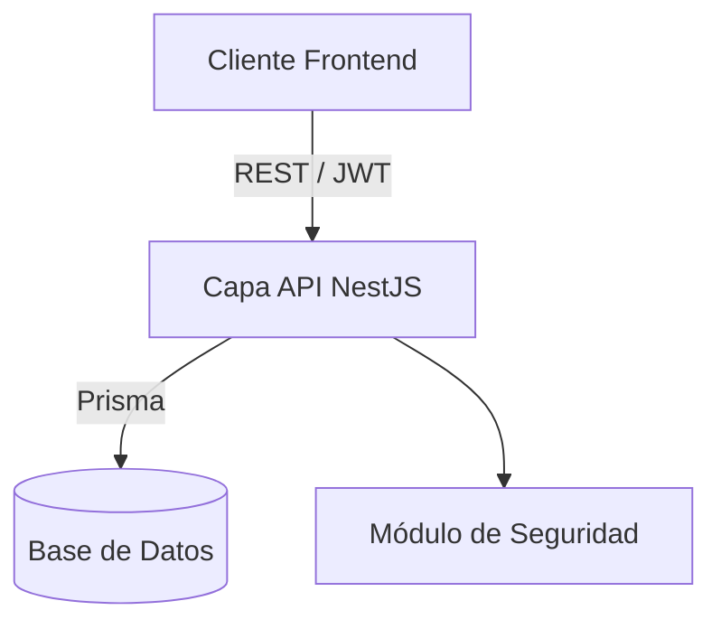

# HealthOps Backend - Visión General

## Contexto del sistema en el ecosistema
El backend actúa como la unidad central de procesamiento y almacenamiento de datos para la plataforma HealthOps. Provee APIs RESTful que son consumidas por el cliente frontend y se comunica con la base de datos para gestionar de forma segura las operaciones.

## Arquitectura general

## Componentes principales
- **Módulo de Actividad**: Gestiona tratamientos, sesiones, admisiones y reportes vinculados con servicios al paciente.
- **Módulo de Pacientes**: Maneja el directorio y registros activos de los pacientes de la organización.
- **Módulo de Configuración**: Administra perfiles profesionales, parámetros del sistema, reglas de honorarios y los datos de la clínica.
- **Módulo de Autenticación**: Asegura que los servicios sean accedidos correctamente mediante control de identidad.

## Integraciones con sistemas externos
- Integración de persistencia y base de datos mediada a través del ORM Prisma.

## Flujos de negocio principales
1. **Autenticación al Sistema**: Inicio de sesión mediante credenciales para obtener token JWT y operar con seguridad.
2. **Gestión de Cargas**: Los profesionales registran sus ítems de trabajo y servicios impartidos diariamente.
3. **Evaluación de Honorarios**: El sistema evalúa reglas preestablecidas para valorizar e impactar cada sesión de manera automática.
