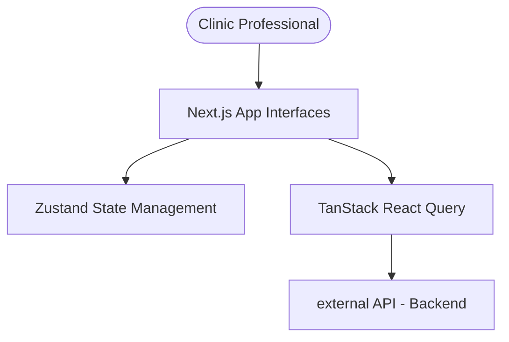

# HealthOps Frontend - System Overview

## Context in the Ecosystem
This Next.js application acts as the primary user interface for HealthOps. It connects to the backend API to fetch and mutate real-time data, providing a structured layout for medical clinic administration tasks.

## General Architecture

## Main Components
- **Dashboard Views**: Real-time insights outlining the professional's activity and pending metrics.
- **Patients Directory**: Interfaces for searching, reviewing, and creating patient records.
- **Activity Tracker**: Work items entry forms, dynamically reacting to fee-rule evaluations.
- **Config & Layout**: Sidebar layouts and settings pages to handle the user profile.

## Integrations with External Systems
- Backend API REST Interface (the primary interaction point for the application domain).

## Main Business Flows
1. **Navigating Activity Requirements**: The user seamlessly navigates through a structured form to register executed daily medical tasks.
2. **Visualizing Performance & Settlements**: The system calculates UI presentations for pending remunerations alongside finished settlement intervals.
3. **Configuration Tracking**: An administrator can visualize rule sets and categorical updates mapped tightly with domain resources.
