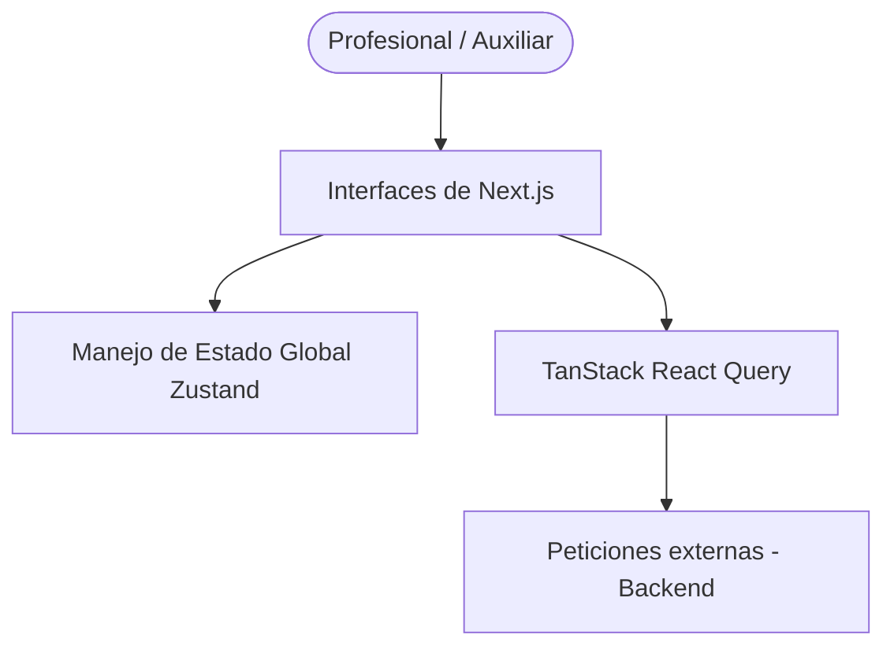

# HealthOps Frontend - Visión General

## Contexto del sistema en el ecosistema
Esta aplicación construida con Next.js opera como la principal interfaz de usuario de la plataforma HealthOps. Es la encargada de consumir las APIs del backend para presentar informaciones críticas en tiempo real y permitir al equipo realizar tareas asociadas a una clínica.

## Arquitectura general

## Componentes principales
- **Vistas de Dashboard**: Resúmenes en tiempo real con estadísticas y análisis correspondientes a la carga actual del usuario.
- **Directorio de Pacientes**: Interfaces dinámicas diseñadas para buscar, auditar o registrar a los pacientes.
- **Seguimiento de Actividad**: Formularios de trabajo, que reaccionan con condicionales frente a tipificaciones de sesiones o admisión.
- **Diseño Base y Configuraciones**: Paneles y páginas de ajustes provistos a través del rediseño UI para manejar el perfil.

## Integraciones con sistemas externos
- La interfaz API REST interna orientada al Backend de la organización.

## Flujos de negocio principales
1. **Navegar Exigencias Visuales**: El usuario es guiado por un sistema de menús optimizado para introducir ágilmente los registros de atención y turnos completados.
2. **Consultar Desempeño y Liquidaciones**: El sistema despliega resúmenes estéticos y comprensibles frente a intervalos históricos de pago.
3. **Manejo de Roles**: Facilidad que goza la directiva al manipular perfiles mediante paneles claros sin acceso a implementaciones backend.
